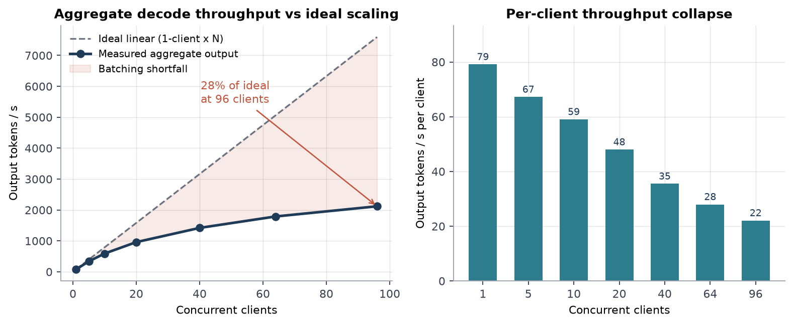
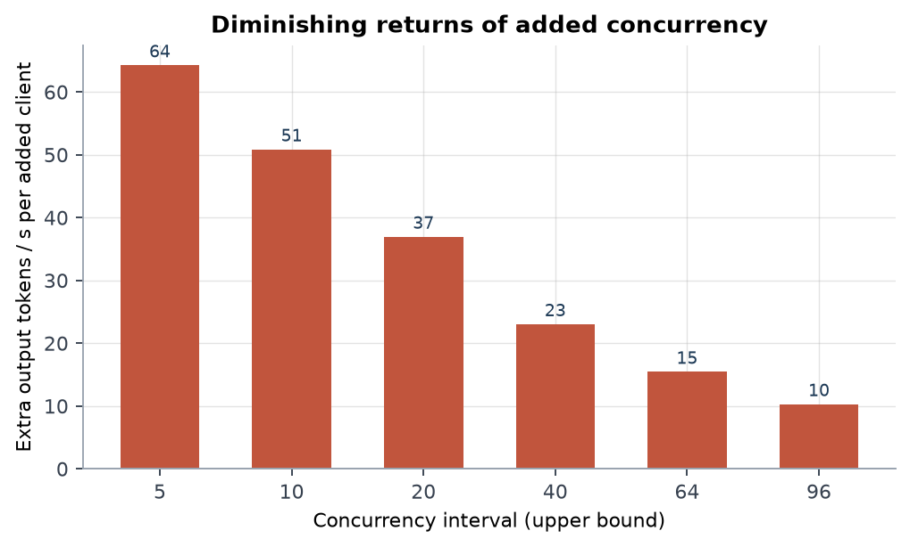
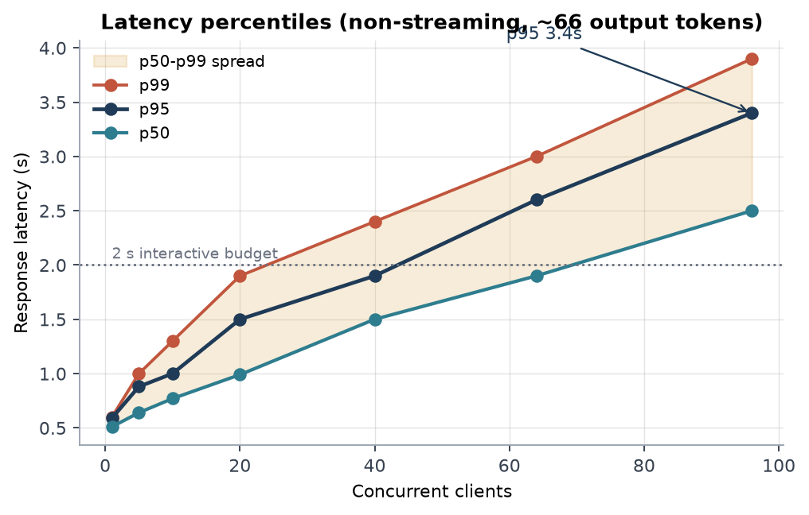
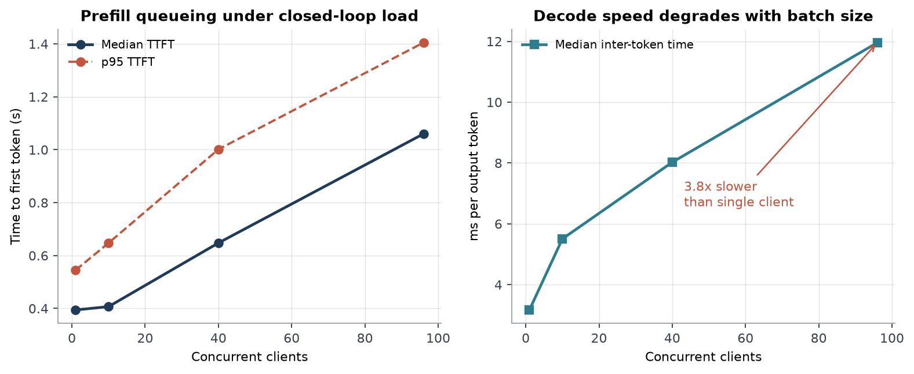
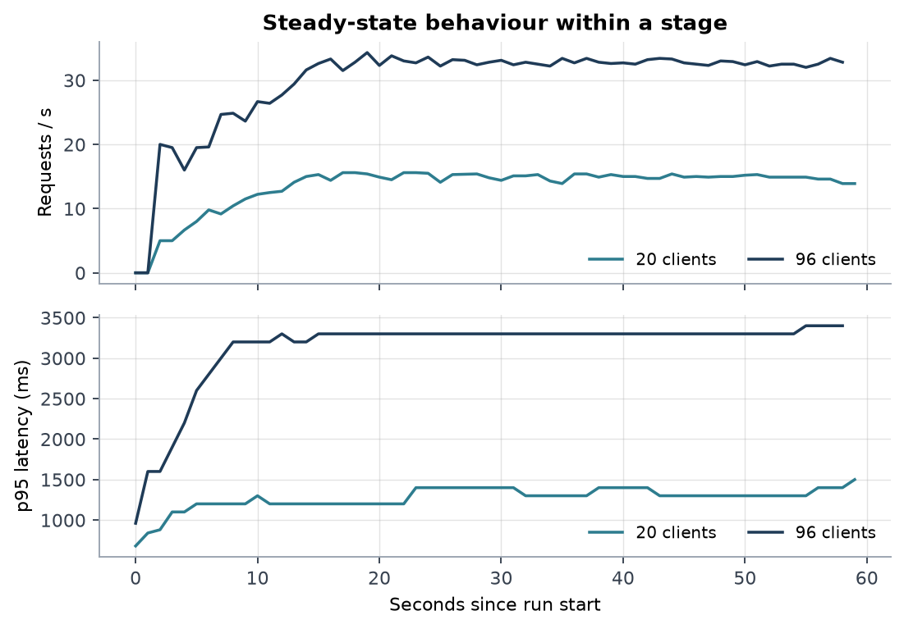
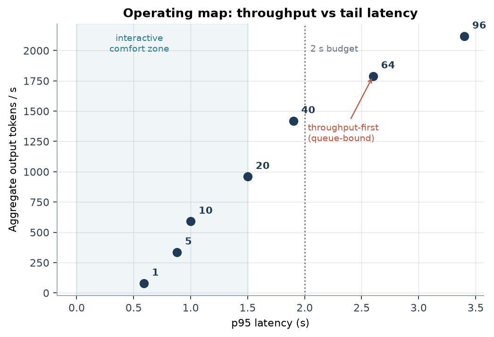

# vLLM Inference Endpoint - Load Test & Capacity Report

**Target:** `http://iiat.gonzaga.edu:30000`  
**Date:** 2026-10-15  
**Tooling:** Locust 2.46.7 + pixi, custom streaming TTFT probe

## Verdict

The endpoint is solid and predictable up to roughly 40 concurrent clients, where it sustains 1420 output tokens/s at a p95 of 1900 ms with zero errors. Pushing to 96 clients still adds throughput (2118 tok/s) but the gain comes entirely from queueing - p95 reaches 3400 ms and per-token speed drops to 12 ms/token. There is no evidence of a hard ceiling below 96 clients, and no evidence of graceful overload handling either.

## Key numbers

| Metric | Value | Context |
| --- | --- | --- |
| Peak sustained throughput | **2,118 tok/s** | @ 96 clients (locust) / 2,834 tok/s closed-loop |
| Errors observed | **0.00%** | 6,437 chat requests + 294 streaming samples |
| Interactive envelope | **<= 20 clients** | p95 1500 ms |
| Best throughput/latency | **40 clients** | p95 1900 ms at 1420 tok/s |
| Scaling efficiency @ 96 | **28%** | of linear extrapolation from 1 client |
| TTFT growth 1 -> 96 | **2.7x** | 0.39s -> 1.06s median |

## Measured results

| Clients | req/s | tok/s | tok/s / client | avg ms | p50 ms | p95 ms | p99 ms | max ms | fail % |
| --- | --- | --- | --- | --- | --- | --- | --- | --- | --- |
| 1 | 1.1 | 79 | 79 | 513 | 510 | 590 | 600 | 602 | 0.0% |
| 5 | 4.9 | 336 | 67 | 674 | 640 | 880 | 1000 | 1154 | 0.0% |
| 10 | 8.8 | 590 | 59 | 790 | 770 | 1000 | 1300 | 1422 | 0.0% |
| 20 | 14.2 | 960 | 48 | 1046 | 990 | 1500 | 1900 | 3079 | 0.0% |
| 40 | 21.1 | 1420 | 35 | 1507 | 1500 | 1900 | 2400 | 2733 | 0.0% |
| 64 | 26.5 | 1790 | 28 | 1970 | 1900 | 2600 | 3000 | 3781 | 0.0% |
| 96 | 31.4 | 2118 | 22 | 2569 | 2500 | 3400 | 3900 | 5231 | 0.0% |

_Totals: 6,437 chat requests, 0 failures, 434,362 output tokens, 294 streaming probes._

## Figures

*Throughput scaling against the linear ideal, with the per-client share*

*Marginal value of each additional concurrent client*

*Latency percentiles as concurrency grows*

*Time to first token and inter-token latency (streaming probe)*

*Within-stage stability: offered load and p95 over 60 s*

*Throughput vs tail latency, with recommended zone*

## Strengths

- **Faultless under load.** 6,437 chat completions plus 294 steady-state streaming samples completed with zero HTTP errors, zero connection resets and zero client timeouts across every stage.
- **No latency creep inside a stage.** Per-second p95 in the 20- and 96-client runs is flat after ramp-up (see stability figure) - no GC pauses, no KV-cache thrashing, no queue growth over 60 s.
- **Continuous batching genuinely works.** Moving 1 -> 20 clients multiplies throughput 12.1x; 1 -> 40 yields 17.9x on a fixed 2-GPU tensor-parallel deployment.
- **Tail stays tight in the interactive zone.** At 40 clients p95/p50 is only 1.27 and p99 is 2400 ms - chat users see predictable responses.
- **Fast prefill.** Median time to first token is 0.39s unloaded and still 1.06s at 96 clients, so perceived responsiveness survives heavy load.
- **Healthy control plane.** `/health` answers in ~7 ms and `/v1/models` in ~21 ms even while every worker is saturated, so orchestrator probes will not false-alarm.

## Shortcomings

- **Sub-linear scaling beyond ~20 clients.** Aggregate throughput reaches only 28% of the linear ideal at 96 clients; each extra client past 64 buys ~10 tok/s versus ~51 tok/s between 5 and 10 clients.
- **Queueing, not capacity, dominates above 40 clients.** Latency grows almost proportionally to concurrency (p95 1900 ms -> 3400 ms) while throughput gains shrink to +18% for +50% clients - requests are waiting, not computing.
- **Per-token speed collapses.** Median inter-token time rises from 3.2 ms to 12.0 ms (3.8x) between 1 and 96 clients - long generations stream noticeably slower when the box is busy.
- **No visible overload protection.** Failures stayed at 0% rather than turning into fast 429s, which implies the request queue is effectively unbounded. Behaviour past the saturation knee is unverified (the 160-client stage was aborted) and unbounded queueing eventually shows up as multi-second stalls or client timeouts.
- **Half the host is idle for serving.** The deployment is tensor-parallel across GPUs 0-1 only; GPUs 2-3 carry an unrelated co-tenant job, so there is no second replica and no failure redundancy for this endpoint.
- **Benchmark is a short-generation, short-prompt regime.** Mean output was only ~66 tokens (the poem prompt hits EOS early) and prompts were ~18 tokens. Long prompts (prefill-bound) and 1k+ token generations stress KV cache and prefill much harder, so peak concurrency will be materially lower for realistic RAG/agent traffic.
- **No server-side telemetry.** GPU utilisation, KV-cache occupancy, preemption/eviction counts and running/waiting queue depth were not captured, so the saturation knee cannot be attributed to compute, bandwidth or scheduler limits.
- **Model identifier leaks a filesystem path.** `/v1/models` publishes `/scratch/models/Qwen3.8-Flash-Next-NVFP4/` as the served id - harmless internally, but it exposes internal storage layout if the port is ever reachable externally.

## Recommended operating envelope

| Use case | Concurrency | Observed cost | Note |
| --- | --- | --- | --- |
| Interactive chat / agent step | <= 20 clients | p95 1500 ms, TTFT ~0.4 s | safest UX; 14 req/s headroom |
| Balanced default | 40 clients | p95 1900 ms, 1420 tok/s | best throughput per unit of latency |
| Throughput-first batch/offline | 64-96 clients | p95 2600-3400 ms, 1790-2118 tok/s | accept slower per-token streaming |
| > 96 clients | not validated | unknown | 160-client stage aborted; re-run before committing |

## Test conditions

- Target: `http://iiat.gonzaga.edu:30000` - vLLM serving `/scratch/models/Qwen3.8-Flash-Next-NVFP4/` (max context 262,144 tokens), tensor-parallel across 2x H100 NVL 95 GB.
- Load generator: Locust 2.46.7 in a pixi environment (Python 3.12), single client host, closed-loop with 0.1-0.5 s think time.
- Workload: non-streaming `/v1/chat/completions`, fixed 18-token prompt, `max_tokens=256`, temperature 0.7, mean output ~66 tokens (model stops at EOS).
- Stages: 1, 5, 10, 20, 40, 64, 96 concurrent clients, 60 s each (20 s for the single-client baseline), ramp 1 client/s; plus a separate closed-loop streaming probe (1/10/40/96 clients, 3 rounds, TTFT + inter-token time measured from SSE chunks).
- Environment caveat: GPUs 2-3 were running another user's six-process Python job during the tests; GPUs 0-1 (which serve this model) were otherwise idle.

## Recommended next steps

1. Re-run the 128/160/256-client stages to locate the true ceiling and confirm whether overload fails gracefully (expect 429/503 once `--max-num-seqs` and queue limits bite).
2. Repeat with a realistic workload mix: 1k-4k token prompts and 512-1k token outputs, plus a long-context tier, to size KV cache and prefill capacity.
3. Capture server metrics alongside the client (`vllm:num_requests_running/waiting`, `gpu_cache_usage_perc`, `time_to_first_token_seconds`, GPU util/power) so the knee can be attributed.
4. Add `--csv-full-history`-based SLA reporting plus a soak run (30+ min) to catch drift, and test 2 replicas (TP=1 on GPUs 0/1 + 2/3) against TP=2 for throughput and resilience.
5. Gate the endpoint behind a rate limiter or client-side concurrency cap sized to the 40-client envelope, and set an explicit client timeout (currently 300 s).
